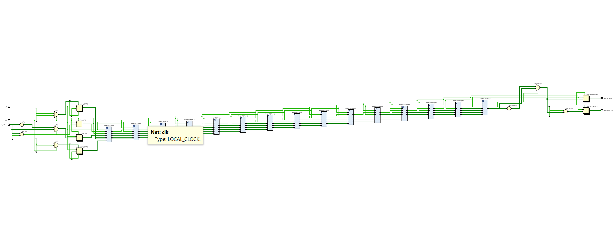
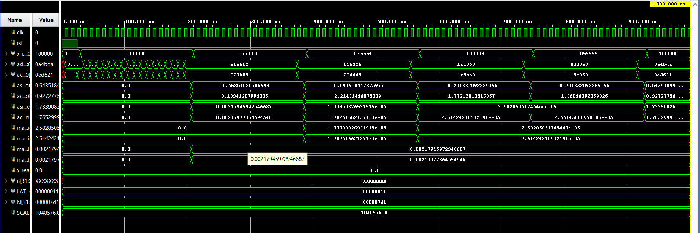
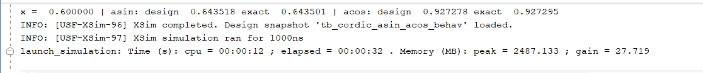
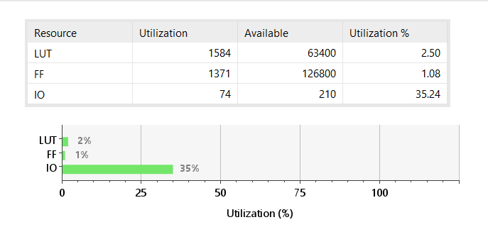

# Results and Performance Analysis

## 1. RTL Schematic

The RTL schematic represents the hardware architecture of the proposed CORDIC-based arcsine and arccosine calculator.

The design consists of a top-level module connected to multiple pipelined CORDIC stages.

## 2. Functional Simulation

Functional simulation was performed using Xilinx Vivado 2023.2 to verify the operation of the Verilog design.

The simulation waveform shows the clock, reset, input values, and corresponding arcsine and arccosine outputs.

## 3. Numerical Verification

The calculated outputs were compared with the reference mathematical values.

For an input value of x = 0.6, the following results were observed:

| Parameter | Design Output | Reference Output | Absolute Error |
|---|---:|---:|---:|
| Arcsine | 0.643518 | 0.643501 | 0.000017 |
| Arccosine | 0.927278 | 0.927295 | 0.000017 |

The observed absolute error for both outputs is approximately 1.7 × 10⁻⁵ radians for this test sample.

### Simulation Console Output

## 4. FPGA Resource Utilization

Synthesis was performed using Xilinx Vivado 2023.2 for the Artix-7 FPGA device (xc7a100tcsg324-1).

The resource utilization results are shown below.

| Resource | Used | Available | Utilization |
|---|---:|---:|---:|
| LUT | 1,584 | 63,400 | 2.50% |
| Flip-Flops | 1,371 | 126,800 | 1.08% |
| IO | 74 | 210 | 35.24% |
| DSP Blocks | 0 | 240 | 0% |
| Block RAM | 0 | 135 | 0% |

The design primarily utilizes LUT-based logic and flip-flops without requiring dedicated DSP blocks or block RAM.

### Resource Utilization Report

## 5. Conclusion

The simulation results demonstrate the functional operation of the CORDIC-based arcsine and arccosine calculator.

The synthesis report shows that the design can be mapped onto an Artix-7 FPGA using LUTs and flip-flops, without utilizing dedicated DSP or block RAM resources.

Further timing analysis and FPGA board-level testing can be performed to evaluate the design under actual hardware conditions.
